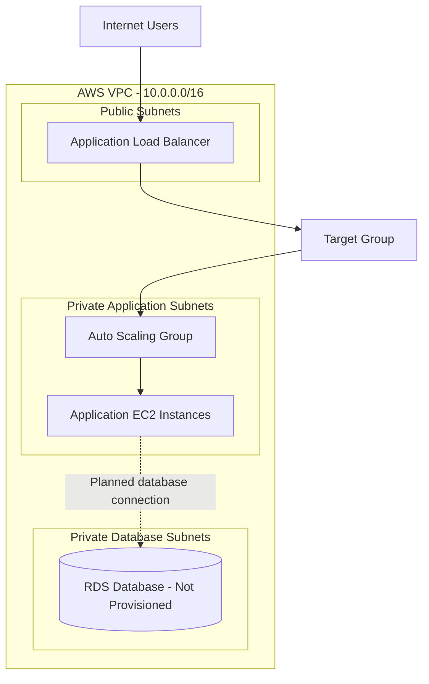

# Phase 10: Final Review and Architecture

## Objective

Review the AWS three-tier Terraform project, document its architecture, and prepare it for portfolio presentation without deploying AWS resources.

## Architecture Overview

**Important:** This diagram represents the intended architecture in the Terraform project. It does not represent deployed or verified AWS resources. The database is a design only; no RDS instance has been provisioned.

## Project Components

| Component | Project status |
|---|---|
| VPC and subnet configuration | Defined in Terraform |
| Internet Gateway and route tables | Defined in Terraform |
| Security groups | Defined in Terraform |
| Application Load Balancer and listener | Defined in Terraform |
| Launch template and Auto Scaling Group | Defined in Terraform |
| Database tier | Design documented; RDS not provisioned |
| Remote state | Approach documented; backend not initialized |
| GitHub Actions | Workflow completed successfully |
| AWS deployment | Not performed |

## Validation Results

The following checks have passed:

- Terraform formatting check
- Terraform initialization with `-backend=false`
- Terraform configuration validation
- GitHub Actions Terraform CI workflow

These checks validate the configuration but do not confirm that the infrastructure works in a live AWS environment.

## Deployment Readiness Notes

Before any future deployment:

1. Select and verify a compatible AMI for the application launch template.
2. Ensure private application instances can obtain required packages and container images. Private subnets currently have no NAT Gateway or documented alternative egress path.
3. Verify the target group's health-check path matches the application response.
4. Review network access, IAM permissions, secrets management, and database connectivity.
5. Review AWS pricing and obtain explicit approval before creating resources.

## Cost and Safety

- No AWS resources have been deployed for this project.
- Do not run `terraform apply` as part of this portfolio review.
- NAT Gateways, load balancers, EC2 instances, and RDS can incur charges if provisioned.
- GitHub Actions usage is subject to applicable account limits and pricing.

## Final Checklist

- [x] Terraform configuration validated locally
- [x] GitHub Actions workflow passed
- [x] Phase documentation created for Phases 1–9
- [x] Architecture documented
- [ ] Review root README for portfolio presentation
- [ ] Commit and push Phase 10 documentation
- [ ] Verify final repository status

## Conclusion

This repository demonstrates Terraform infrastructure design, AWS networking concepts, security-group planning, load-balancing and scaling configuration, remote-state planning, and automated CI validation. It is a configuration and documentation portfolio project, not a deployed production environment.